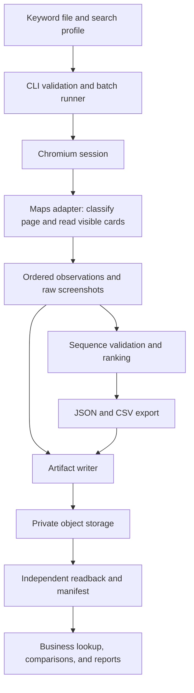
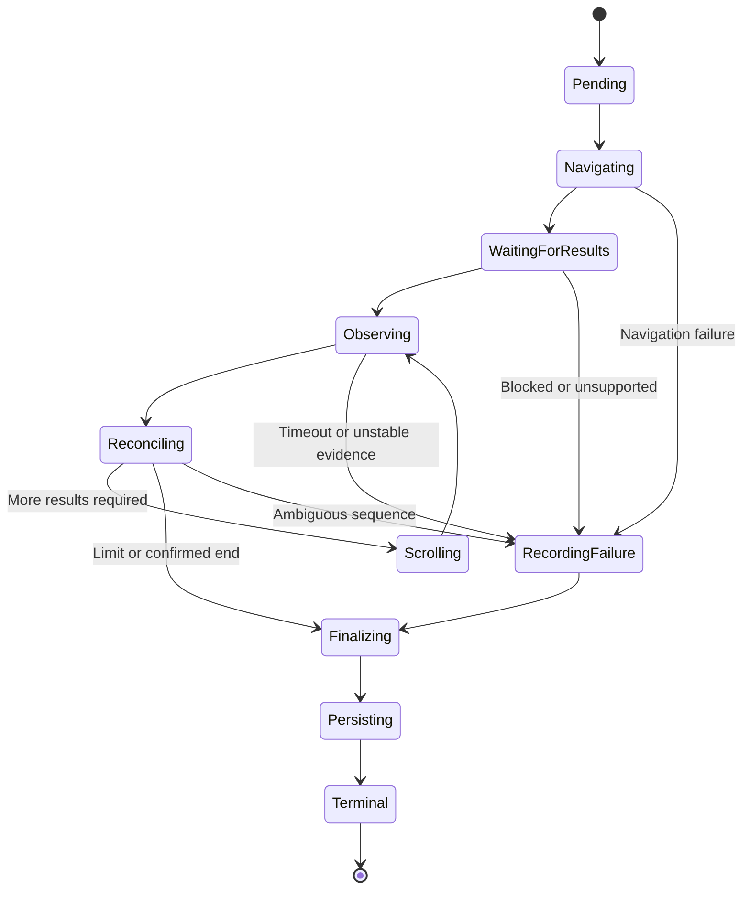

# Detailed Design

Status: implemented for local collection, proposed for delivery. The local collector described in sections 3 to 10 exists and has been validated locally under fixture tests and in one end-to-end run of four keywords against the live site; see [validation status](validation-status.md) for what that run did and did not show. Azure Blob delivery, the container image, the Kubernetes Job, and target-Pod acceptance are not implemented or validated. The unreleased TypeScript contracts reflect the design and have compile-time regression checks; runtime schema validation of external JSON is still required.

Decisions made on 2026-09-17 that refine this design (Chromium instead of Chrome, 15 listings, query-only location behavior, Azure Blob target, DOM-index reconciliation) are recorded with their rationale in [Decisions and Deviations, 2026-09-17](superpowers/specs/2026-09-17-keyword-capture-design.md). This document has been updated to match.

## 1. Product definition

Maps Keyword Capture records what a signed-out Chromium session observes when searching Google Maps for a keyword. It produces structured business listings, explicit ad classifications, and screenshots that support the observed order.

The unit of work is a keyword under a recorded search profile, not a target business. Consumers can locate any business after collection. The output describes a bounded observation at a particular time, not a universal or permanent ranking.

### Scope of the first usable version

- Accept a JSON configuration or a UTF-8 CSV keyword list; keep one JSON settings file as the canonical configuration.
- Process up to 20 keywords per batch and up to 15 displayed business listings per keyword by default, including ads.
- Use desktop Google Maps, an English-language page profile, and the Chromium bundled with the official Playwright image, controlled through Playwright.
- Capture the visible results list and map, scroll the results list, preserve business occurrences, and calculate supported rankings.
- Export per-query JSON, CSV, PNG files, raw observations, and an attempt manifest.
- Run the same collector locally and in a dedicated Kubernetes Job; persist cluster outputs to private object storage.

The first version does not require an LLM, OCR, a database, a queue, a dashboard, or a Core AI Agent session. It does not enrich listings by opening every business detail page. Extra language layouts, scheduled execution, and report generation are later work.

## 2. Architecture and alternatives

The selected architecture is a deterministic CLI with an isolated Google Maps adapter, packaged as a batch container. The container is based on the official Playwright Linux image matching the pinned Playwright version, which bundles Chromium and its system dependencies; Google Chrome is not installed. [Playwright Docker documentation](https://playwright.dev/docs/docker)



| Alternative | Decision | Reason |
|---|---|---|
| Independent batch CLI and Job | Selected | Matches bounded keyword work and isolates browser resources from Core AI sessions. |
| Script inside an existing sandbox | Diagnostic fallback only | Adds a dependency on another runtime's lifetime, resource limits, and cancellation behavior. |
| Long-running worker plus queue | Defer | Useful for concurrent users and continuous workloads; unnecessary for the initial manual batches. |
| Screenshot interpretation by an LLM | Defer to optional review | The main collector needs explicit, testable classification and ordering rules. |
| Data API as the primary source | Not selected for this product | The requirement is evidence of the observed browser page, including its ad placements and screenshots. |

### Planned module boundaries

| Module | Responsibility | Must not do |
|---|---|---|
| `cli` / `config` | Validate configuration, resolve input, create IDs, print output locations | Treat invalid configuration as a successful empty run |
| `runner` | Sequential scheduling, deadlines, attempt accounting, cleanup | Contain Google-specific selectors |
| `browser` | Launch Chromium, create isolated contexts, close/recycle processes | Reuse an authenticated personal profile |
| `adapters/google-maps` | Page states, query submission, visible card extraction, scroll actions | Assign an unsupported global rank |
| `sequence` / `ranking` | Reconcile overlapping observations and derive rankings | Deduplicate all occurrences by business ID |
| `evidence` | Capture PNGs, coordinates, signatures, and observation timestamps | Modify the page to make a desired ranking appear |
| `export` | Schema validation and safe JSON/CSV output | Replace missing values with zero |
| `storage` | Upload, readback verification, manifest publication | Treat a successful upload request as verified delivery |

These are planned boundaries, not existing source files.

## 3. Input, configuration, and identity

The existing [example configuration](../examples/keywords.json) remains the starting point. CSV input initially requires a `keyword` column; optional descriptive labels may be retained but must not change the query. Settings such as locale and limits come from the JSON file, not per-row free-form commands.

Validate nonempty keywords, maximum batch size, positive integer limits, valid IANA timezones, bounded viewport dimensions, and writable output locations. Reject unknown configuration fields to catch typos. Preserve each original keyword; normalize only a separate filename/lookup representation. Do not silently merge repeated input rows: assign each row a distinct query ID and show the duplicate count before execution.

| Identifier | Meaning |
|---|---|
| `runId` | One requested batch, assigned by the caller before launch |
| `attemptId` | One worker execution; unique across duplicate Pods or manual reruns |
| `queryId` | Stable input-row identity within a run, including the row index |
| `queryAttemptId` | One browser attempt for a keyword; a retry receives a new ID |
| `observationId` | One stable visible-page observation linked to screenshots |
| `occurrenceId` | One occurrence in the reconstructed results list |
| `businessKey` | Optional business association key; never the sole occurrence key |

Record a hash of canonical configuration, a separate hash of the search profile, the adapter version, source commit, browser version, and container image digest when available. Unknown values remain null. The search profile hash excludes timestamps and query text so that it can group compatible observations; it includes collection surface, locale, viewport, configured location behavior, and an egress-profile identifier when known.

## 4. Search profile and location

Default profile: desktop viewport 1440 × 1000, device scale factor 1, locale `en-US`, browser timezone `America/New_York`, signed out, no manual filters, and no browser geolocation permission. Filenames use `Asia/Shanghai` unless configured otherwise. Browser timezone and filename timezone serve different purposes.

The first version uses query-only search: submit the original keyword without a configured map center, zoom, or simulated browser geolocation. A supported entry point is `https://www.google.com/maps/search/?api=1&query=<encoded keyword>`, constructed with URL utilities and no location parameters. Do not pan the map, click "Search this area", grant geolocation permission, or append a city to the query. Google may reposition the map itself; record that outcome rather than forcing a preferred area. [Google Maps search URLs](https://developers.google.com/maps/documentation/urls/get-started#search)

`mapView` is optional in the input contract and reserved for a later explicit area-search mode. Omit it from first-version inputs. Until that mode is implemented, supplying it must produce a clear unsupported-configuration error rather than silently applying or ignoring it. Results record `locationMode: "query_only"` and `configuredMapView: null`; record any observed map view separately from requested settings.

Queries such as `bubble tea garden city` express an area name but do not guarantee an unambiguous city. The recovered [query-only screenshot](../evidence/2026-09-17/screenshots/q_bubble_tea_garden_city.png) shows a broad US map and geographically mixed card details; [the archive](../evidence/2026-09-17/README.md) explains the limits of that observation. Generic, ambiguous, and "near me" queries remain valid raw queries, but their results must be described as observations from the runner's environment. Do not automatically rewrite queries or infer a customer-local rank. A caller may explicitly submit a more specific keyword as a new input. Record any observed ambiguity in quality warnings with evidence references; automatic geographic detection is not implemented. The previously recorded Virginia egress is context to retain, not a reason to inject a map center. No explicit location input does not mean location-independent results.

Record requested and observed conditions separately: configured map view, final URL, visible location text if available, active filters, account state, browser version, and configured egress region/source. Do not guess actual Google-inferred location from these fields. Google can use multiple location signals, including network address and prior activity; fixed browser coordinates alone do not establish equivalence with a user's desktop search. [Google location guidance](https://support.google.com/websearch/answer/179386?hl=en)

Create a fresh context per keyword attempt. Reuse a browser process within the batch, recycling it after a crash or every five completed keywords as an initial operational default. Close each context in `finally`. A future persistent consent profile would be a separately documented profile, not a silent behavior change.

## 5. End-to-end execution

1. Validate the complete input before launching the browser. Write the resolved configuration and a manifest containing every input row as `pending`.
2. Verify that Chromium launches; log its actual version. A startup failure must not produce empty successful results.
3. For the next keyword, create a clean context, assign a query-attempt ID, and start its deadline.
4. Open Google Maps and submit the keyword through the supported adapter. Build any URLs with proper query encoding; never pass keyword text through shell interpolation.
5. Classify the page: search results, explicit no-results state, consent, CAPTCHA, unsupported layout, detail page, or navigation error.
6. Confirm the visible search input matches the intended keyword and that the supported results layout is ready. Record any visible query correction rather than silently treating it as the original query.
7. Capture a stable observation, extract cards, reconcile list order, and save supporting screenshots.
8. Scroll only the results pane and repeat until a terminal condition or budget is reached.
9. Finalize classification and ranking, persist the screenshot/observation evidence, then validate and export JSON/CSV and persist them with readback checks.
10. Checkpoint the attempt manifest, close the context, and continue. At the end, publish the final attempt manifest and report its path or object key.



An explicit no-results page is a valid captured observation with zero rows and screenshot evidence. An empty DOM query is not evidence of no results. A business detail page is not automatically a first-place search result; the adapter must recover a list or mark the query unsupported.

## 6. Readiness and evidence consistency

Readiness is based on the page state: matching query, recognized results container, usable visible cards or explicit empty-state text, and a renderable map. Use locators and bounded stability checks; do not wait indefinitely for all network activity to cease. Playwright discourages relying on `networkidle` for readiness. [Page API documentation](https://playwright.dev/docs/api/class-page#page-wait-for-load-state)

Proposed stability loop, bounded by the query deadline:

1. Read visible cards in visual top-to-bottom order, with occurrence fingerprints, ad labels, bounding boxes, and scroll offset.
2. Repeat after 500 ms. If the identity/order/label signature is unchanged and the layout is usable, take a viewport screenshot.
3. Immediately read the same signature again. Only accept the observation if the pre- and post-screenshot signatures match.
4. Retry this observation at most twice. Continued changes produce `unstable_results` and partial output rather than unsupported evidence.

These checks reduce data/image races; they do not make the entire page an atomic snapshot. Preserve screenshot timestamps, bounding boxes, signatures, and validation results. Each emitted occurrence must have at least one accepted screenshot where its name and classification evidence are readable. Repeated fixed headers are not additional business occurrences.

Use the original viewport PNG as evidence. Optional card crops are derived artifacts referencing an original screenshot; they are not a substitute for the list context. Do not hide competing businesses, remove ad labels, rearrange cards, or add a first-place label to the raw capture.

## 7. Listing extraction and ad classification

Extract only information visible in the results card: business name, exposed business URL/identifier, address, rating, review count, category, and raw card text. Missing fields remain null. Detail enrichment, if later added, runs separately and must not replace the original ordering evidence.

Store the observed Maps URL unchanged. A separate canonical association URL may remove known tracking noise, but preserve identity-bearing parameters and never treat an arbitrary URL token as a Place ID. A normalized name/address fallback is a weak association signal, not a unique identifier.

| Classification | Required evidence | Ranking treatment |
|---|---|---|
| `ad` | Recognized explicit sponsored/ad label associated with this card or its enclosing placement | `organicRank = null`; retain exact label and its source |
| `organic` | Recognized and fixture-tested card layout, with all supported ad-label locations evaluated and no ad evidence | Eligible for an organic rank only if preceding classifications and sequence are verified |
| `unknown` | Unsupported structure, conflicting signals, ambiguous label ownership, or incomplete render | Keep occurrence and evidence; do not invent a classification |

The absence of the word "Sponsored" alone is not a general organic classifier. Ad markers can belong to a group; the adapter must establish which cards the marker covers. Unrecognized language or ad structures fail closed to `unknown` or `unsupported_layout`.

No live selector set is specified as verified in this design. The first implementation milestone must inspect current pages, establish label ownership, and create sanitized fixtures for supported layouts. Parser changes require a new adapter version.

Recovered laptop evidence, 2026-09-17: the centered-map Chromium [first screenshot](../evidence/2026-09-17/screenshots/ad_shot_00.png) visibly shows a Sponsored Gong Cha card; a [later screenshot](../evidence/2026-09-17/screenshots/ad_shot_02.png) shows Gong Cha with the same address/phone and no visible Sponsored label. This supports keeping both occurrences, but does not validate a production organic classifier. Earlier notes reported browser version 153.0.8010.12, a later display position of 11, a leaf `span` six levels deep, and an enclosing `aria-label="Sponsored"`. The inspection script was recovered, but its DOM/stdout output was not; those details remain historical reports pending fixture validation. Do not mix rating examples from another card into the Gong Cha evidence. Thumbnail and Website/Directions layouts are visible in the archive; both, plus group-level labels and unsupported structures, require parser fixtures.

## 8. Ordering, deduplication, and rankings

### Two different positions

`displayPosition` is a one-based position in the verified observed business-results list, counting ads. `organicRank` excludes confirmed ads. Ads also retain their display position. Non-business banners do not consume a position, but the adapter must distinguish them explicitly.

For an organic occurrence at position i, if every position from 1 through i has verified order and classification:

```text
organicRank(i) = count(confirmed organic occurrences at positions 1..i)
```

An unknown classification at position 4 does not invalidate verified organic ranks at positions 1–3. It does make organic ranks after position 4 unknown. Display positions may remain known when only ad classification is uncertain. If list continuity itself is uncertain, do not emit a new definitive display position beyond the last verified prefix.

### Reconcile scroll overlap

- Start from the top of the list and verify the initial scroll position.
- Classify every feed child explicitly before using indices. Historical laptop notes reported the following structure in headless Chrome and Playwright Chromium (raw DOM logs were not recovered; revalidate before enabling this adapter): children 0 and 1 are header nodes (the filter bar with zero height, and the "Results" header); business cards start at child 2 and occupy even indices; odd indices are 1px separator nodes; after the last mounted card come a loading spacer and promotional blocks ("limited view", "Sign in"). Header, card, separator, and trailer are the four recognized kinds; any child that matches none of them produces `unsupported_layout`.
- Use the card's index among the feed's children as the primary placement key, combined with the place identifier and the ad flag. The proposed supported layout requires an append-only feed with stable mounted-card indices; this is a condition to verify, not a guarantee about Google Maps. Derive the card stride and start offset from the classified first screen, never hard-code them. Historical notes reported the stride holding with the Sponsored card; a card that breaks the stride still produces `unsupported_layout`, not a guessed position.
- Re-verify the committed `index -> occurrence` mapping on every round, not only the new suffix. For each committed index that is still mounted, the place identifier, the ad flag, and the name must be unchanged. A replacement at the same index (`[A,B,C]` becoming `[X,B,C,D]`), a committed index that disappears while later indices remain, or an ad-type change on a committed card invalidates the prefix from that index onward: scroll back once to the top of the affected region and re-read; if the mismatch persists, terminate with `sequence_ambiguous` and preserve the prefix before the first mismatch.
- Verify visual order against DOM order on every round: bounding-box tops must increase with index. A violation, a known occurrence reappearing at a different index, or a gap in the index sequence terminates with `sequence_ambiguous` and preserves the last verified prefix.
- Append only new indices that extend the verified prefix contiguously.

### Scroll step and screenshot coverage

- Default step: scroll so that the top of the last partially visible card becomes the top of the pane. Require complete readable coverage; oversized cards use the multi-screenshot rule below. Screenshot overlap is for evidence; ordering comes from the verified index sequence.
- No partially visible card at the bottom: keep the last fully visible card as the overlap and scroll it to the top of the pane.
- A card taller than the visible pane: scroll by the pane height inside that card and take consecutive screenshots until its bottom is visible; the occurrence references all of them.
- After every scroll, confirm that `scrollTop` increased or the end-of-list marker appeared. A scroll that does not advance counts toward the stall limit; three in a row produce `load_stalled`.
- When the listing limit is reached and the last accepted card is cut off, take one more screenshot. That screenshot counts toward the screenshot budget. If the budget is already spent, the result is `partial / screenshot_limit` even though the listing limit was reached.
- Keep unmatched observations in the raw observation log. Do not put uncertain entries into the ranked CSV as if their global positions were known.

Same-name businesses, an ad plus an organic listing for one business, and a second legitimate occurrence of one business are not automatically duplicates. A fingerprint may combine business association, placement type, and stable content, but a global set of fingerprints is insufficient: contextual overlap proves duplicate observations.

Example: first viewport `[A-ad, B, C]`, next viewport `[B, C, A-organic]` becomes four occurrences. It must not collapse to three businesses.

If the page reorders between observations, preserve evidence and stop at the verified prefix. Do not splice two different visible sequences into an apparently complete list at the configured limit.

## 9. Bounded collection and failure rules

Initial defaults below are provisional hard budgets, not performance promises. Earlier centered-map probes motivated them, but the recovered scripts scroll by a full pane rather than the proposed overlap algorithm. The query-only archive contains first-screen captures only. Neither archive establishes complete 15-listing coverage within these budgets; validate that separately in the target Pod. Exhaustion must preserve partial evidence rather than claim success.

| Limit | Initial value | Behavior on exhaustion |
|---|---|---|
| Keywords per batch | 20 | Reject larger input; split explicitly into batches |
| Listings per keyword | 15, counting ads and unknown classifications | Stop accepting ranked occurrences at the limit; screenshots may show neighboring extra cards. If the last accepted card is cut off, take one more screenshot |
| Scroll operations | 6; query-only coverage unvalidated | `partial / scroll_limit` |
| Screenshots per query attempt | 5 results screenshots; query-only coverage unvalidated | `partial / screenshot_limit`; do not silently discard evidence |
| Local bytes per keyword, across its attempts | 50 MiB | `partial / artifact_limit` |
| Browser work per keyword, across retries | 90 seconds | `partial` if evidence exists, otherwise `failed`; stop reason `timeout` |
| Final persistence work per keyword | 30 seconds | Preserve diagnostics and mark persistence failed |
| Transient browser retry | At most one, within the original 90-second budget | Restart the keyword in a fresh context and retain separate attempts |
| Stalled scroll checks | Three with unchanged order/offset and no loading indication | `partial / load_stalled`; never assume end-of-results |

Retry a transient navigation error or browser crash. Do not automatically retry CAPTCHA, unhandled consent, unsupported layouts, ambiguous ordering, invalid input, or exhausted deadlines. Do not merge rows from different query attempts. Prefer the earliest complete query attempt; if none completes, retain the earliest attempt with usable evidence, while exposing all attempt outcomes.

A confirmed CAPTCHA opens a batch-level circuit breaker: save its diagnostic evidence and mark unstarted queries `skipped` with `batch_blocked`. Do not repeatedly submit all remaining keywords through the same blocked session. A recognized no-results page does not trip this breaker. Browser launch failure, unavailable persistent storage, or a globally unsupported adapter layout should also stop the remaining batch with explicit reasons.

## 10. Data model and output

### Contracts and remaining runtime validation

[src/contracts.ts](../src/contracts.ts) now defines the following design-aligned, unreleased v1 shapes. [Compile-time tests](../tests/contracts.type-test.ts) check critical type constraints. This is not an executable JSON schema: runtime input/output validation and behavioral fixtures remain implementation work.

| Area | Current TypeScript contract |
|---|---|
| Run metadata | `attemptId`, canonical configuration and profile hashes, source/image/adapter versions |
| Query attempts | IDs, separate timestamps/outcomes, and the selected attempt; never merge observations across attempts |
| Observations | `observationId`, visible occurrence fingerprints, scroll offset, bounding boxes, pre/post signatures |
| Classification | Evidence source and label ownership, not just a nullable `adLabel` |
| Query quality | `verifiedPrefixLength`, classification completeness, warnings, query correction text |
| Location context | `locationMode: "query_only"`, null `configuredMapView`, and separately recorded observed map/location context |
| Terminal reasons | Complete, incomplete, blocked, and skipped reason unions, including `classification_unknown` for an otherwise complete list with unsupported classification |
| Manifest rows | Discriminated skipped rows require a stop reason and cannot claim a selected attempt or result file |
| Persistence | Artifact index covers request/result JSON, CSV, observations, and images; verified state requires a key and readback time. Final manifest readback uses a separate CLI receipt, avoiding a self-verification claim |
| Local-only execution | Represent persistence as `not_requested`, not verified remote delivery |

Runtime validators must still check positive integer positions/limits, valid timestamps and SHA-256 values, configuration rejection (including reserved `mapView`), prefix continuity, screenshot coverage, classification evidence ownership, attempt/artifact references, and selection policy. A captured result requires complete classification and screenshot coverage; use `partial / classification_unknown` if classification is the remaining failure. On cancellation or the batch deadline, a query with usable evidence is `partial` with `cancelled` or `batch_timeout`; without usable evidence it is `failed`, and unstarted inputs are `skipped` with the same reason. A terminal manifest row must match its selected attempt. Storage failure changes delivery status without rewriting collection quality.

Keep `displayPosition` numeric in the ranked output by admitting only the verified prefix. Unordered/unmatched observations stay in the observation log without a claimed global position. This avoids overloading a sequential counter with an unverified ranking.

### File organization

```text
maps-keyword-capture/2026-09-17/<run-id>/<attempt-id>/
  request.json
  manifest.progress.json
  q0001/
    qa01/
      20260917T143025.123+0800__bubble-tea-garden-city__q0001.json
      20260917T143025.123+0800__bubble-tea-garden-city__q0001.csv
      observations.jsonl
      20260917T143025.123+0800__bubble-tea-garden-city__q0001__01.png
    qa02/
      ... separate retry artifacts, never merged with qa01
  manifest.json
```

Each browser attempt writes its own result JSON, CSV, observations, and PNGs. Manifest rows retain every attempt summary and point `resultFile` to the selected attempt; select the earliest captured attempt, otherwise the earliest with usable evidence, otherwise the earliest failed/blocked attempt for diagnostics. No attempt is selected by best rank.

Locally this tree lives under `outputDirectory`; remotely it is the blob prefix inside the `seo` container. The manifest carries the per-artifact object keys, sizes, checksums, and verification times; there is no separate artifact index.

Use UTF-8. JSON timestamps carry an explicit offset; filenames use the configured timezone with numeric offset. Sanitize separators/control characters, normalize Unicode, cap filename length by encoded bytes, and retain original query text in JSON. IDs prevent collisions after sanitization. This layout refines the initial example by adding worker-attempt isolation.

CSV has one row per verified occurrence, with repeated query context so it remains interpretable outside its directory:

```text
run_id,attempt_id,query_id,keyword,captured_at,profile_hash,
display_position,result_type,organic_rank,name,address,rating,
review_count,category,maps_url,place_id,ad_label,screenshot_files
```

Use empty cells for nulls. Apply CSV escaping and spreadsheet-formula protection to external text; JSON retains original strings. Multiple screenshot references are joined consistently and documented. An empty result still writes a header-only CSV, a JSON reason, and an empty-state screenshot.

## 11. Persistence and completion protocol

The local adapter writes into the output directory. The cluster adapter writes to Azure Blob Storage, account `fbrdevstorage`, container `seo`, under the same run/attempt/query tree, using `@azure/storage-blob` with the account name and key from the existing `dev-ai` Secret `azure-storage-account-f6eab793693c54a6891af3c-secret`. The account key grants whole-account access; narrowing to the prefix through workload identity is later hardening. Azure Blob is the only provider in the first implementation, behind a small storage interface.

1. Write local artifacts using temporary filenames followed by same-filesystem rename; calculate SHA-256 and size from final bytes.
2. Upload and verify each keyword's screenshots and observation logs first. Then finalize JSON with those evidence references, derive CSV, and upload and verify both before starting the next keyword. A Pod crash may lose the current unfinished query; it must not erase earlier verified queries.
3. Read each uploaded artifact back through the storage adapter, compare byte count and SHA-256, and decode PNGs. A HEAD request alone does not verify the image content; an object ETag must not be assumed to be a SHA-256 checksum.
4. Update the attempt's progress manifest after each keyword. Mark collection quality and persistence separately.
5. Publish the final attempt manifest last, listing every artifact's object key, size, checksum, and verification time. The manifest excludes itself from those hashes. Read the manifest back and compare it with the expected bytes before printing a verified completion result.

No artifact claims to have verified its own upload: the manifest records verification of previously persisted artifacts, and the final manifest readback is reported externally in the CLI result. Local staging files may be removed only after their remote copies are verified and the progress checkpoint records their object keys.

One attempt is the only writer of its prefix. Temporary progress state is mutable; finalized evidence and manifests are immutable. Storage retry uses the same object key and expected checksum for the same artifact; an existing object with different bytes is a conflict, not something to overwrite silently.

Kubernetes can occasionally start the same workload twice even with a single completion. Assign each execution its own attempt ID, retain both histories, and never combine their rows. [Kubernetes Job failure behavior](https://kubernetes.io/docs/concepts/workloads/controllers/job/#handling-pod-and-container-failures)

The initial version does not promise exactly-once execution or automatic resumption from a destroyed Pod. A follow-up run can explicitly reference a previous manifest and request only missing keywords. Until a controller is implemented, consumers must select an explicit attempt manifest; do not silently select the attempt with the best business rank.

### Collection status versus delivery status

| Collection outcome | Meaning |
|---|---|
| `captured` | Requested scope reached or result list explicitly ended, with valid evidence and supported classification/order |
| `partial` | Usable evidence exists, but the requested scope or quality conditions were not met |
| `blocked` | CAPTCHA or unresolved consent prevented valid collection |
| `failed` | No usable collection due to an error |
| `skipped` | Not attempted because of an explicit batch stop condition |

A batch is fully successful in remote-storage mode only when every query is captured and all required artifacts are independently verified. A partial batch can still have fully persisted evidence. A process exit code is not a replacement for reading the manifest.

Proposed exit codes: `0` for a fully successful run in its declared mode; `2` for persisted partial/blocked/skipped results; `1` for internal or persistence failure; `64` for invalid configuration. Local-only mode must print `remotePersistence: not_requested` even when it exits 0.

## 12. Kubernetes execution

Deploy one independent Job per batch in namespace `dev-ai` of the FBRDev AKS cluster, with one Pod and a dedicated container image built on `mcr.microsoft.com/playwright:v1.63.0-noble`, which contains Chromium, fonts, and runtime libraries. Publish it as `fbrdevacr.azurecr.io/ai/maps-keyword-capture:<git-sha>`, pin the Job to the digest, and record the runtime browser version. Schedule on `nodeSelector: envpool=aiapp` with `imagePullSecrets: docker-registry-secret`, matching the existing `dev-ai` Jobs.

Launch design: `channel: "chromium"` so Playwright uses the full Chromium build in its new headless mode rather than the default headless shell, `headless: true`, and explicitly `chromiumSandbox: true`. Recovered laptop probes include both headless Chrome and the Chromium channel, including an ad sample and three query-only first screens. They do not explicitly enable `chromiumSandbox` and are not equivalent to the target Linux/Pod runtime; sandbox startup, DOM fixtures, rendering, complete query-only coverage, and ad handling remain cluster acceptance gates. [Chromium headless modes](https://playwright.dev/docs/browsers#chromium-new-headless-mode) Playwright's `chromiumSandbox` option defaults to false, so non-root execution alone is not a sufficient configuration statement. Validate the required kernel/seccomp behavior in the target cluster; report a startup incompatibility instead of silently downgrading. [Playwright launch options](https://playwright.dev/docs/api/class-browsertype#browser-type-launch-option-chromium-sandbox)

Use non-root execution, minimal permissions, writable mounts only where needed, and a read-only root filesystem if the tested image supports it. Avoid privileged mode and host IPC. Use an init process and explicit browser teardown; container guidance and the actual image's behavior must be tested together. [Playwright container guidance](https://playwright.dev/docs/docker)

| Setting | Initial proposed value |
|---|---|
| `parallelism` / `completions` | 1 / 1 |
| `restartPolicy` / `backoffLimit` | `Never` / 0; application retries are bounded explicitly |
| CPU request / limit | 500m / 2 |
| Memory request / limit | 1Gi / 2Gi |
| Ephemeral storage request / limit | 1Gi / 3Gi |
| Disk-backed work volume | `emptyDir.sizeLimit: 2Gi` |
| Shared memory | Separate memory-backed `/dev/shm`, 256Mi initial size |
| Termination grace | 30 seconds |
| Finished Job retention | TTL of 24 hours; evidence retention is separate |

These are load-test inputs, not confirmed cluster capacity. Memory-backed volumes count against container memory; keep browser and shared-memory usage within the total budget. [Kubernetes volume behavior](https://kubernetes.io/docs/concepts/storage/volumes/#emptydir)

Compute the application deadline from the configured batch size rather than hard-coding a duration that cannot accommodate the per-query budget:

```text
application budget = startup allowance + N * (browser budget + persistence budget) + finalization allowance
initial example = 60 + N * (90 + 30) + 60 seconds
Job activeDeadlineSeconds = application budget + 60 seconds
```

For 20 keywords this is a 42-minute application ceiling and a 43-minute Job ceiling, not an expected runtime. Tune from measured percentiles. On SIGTERM, stop starting queries, close the active context, save a bounded checkpoint, and terminate remaining browser children before the grace period ends. OOM/SIGKILL cannot guarantee a final checkpoint; durable per-query progress is the recovery evidence.

Inject the storage account name and key from the existing `dev-ai` Secret as environment variables; the container name and prefix come from the ConfigMap. Keep credentials out of input files and Git. No cluster API privileges are needed inside the collector. Validate DNS, Google access, storage access, fonts, writable paths, and Chromium startup in the actual namespace before accepting the deployment.

## 13. Observability, maintenance, and comparison

Write structured logs with run/attempt/query IDs, stage, duration, adapter version, emitted count, ad/unknown counts, stop reason, and persistence state. Preserve browser stderr with bounded log size. Do not emit cookies, credentials, or signed storage URLs. Print a compact final summary and the manifest location.

Track capture success, unknown-classification rate, sequence ambiguity, blocked rate, artifact verification failures, per-query latency, and peak browser memory/disk. Initially these can be summarized from manifests; no metrics service is required for the first version.

A page-layout change should increase explicit unsupported/unknown outcomes, not silently turn ads into organic results. Update sanitized fixtures and the adapter version before changing classification logic.

For downstream comparisons, match the keyword, surface, search profile, limits, and reliable business identity. Report exact observation dates and context differences. "Not observed in the first 15 displayed results" is different from "ranked below 15 organically" and from "no ranking." Ad appearance and organic rank remain separate measures. A screenshot series never establishes causality on its own.

## 14. Validation and delivery gates

| Gate | Evidence required |
|---|---|
| Contract validation | Executable schema rejects invalid inputs; fixtures distinguish null from zero, ads from unknowns, and skipped from empty results |
| Sequence logic | Overlap, repeated businesses, same-business ad/organic pairs, unknown labels, gaps, and reorders yield the expected prefix/ranks |
| Browser fixture tests | Supported synthetic layouts exercise ad ownership, list scrolling, empty states, and unstable screenshot signatures |
| Local live probe | 3–5 actual keywords with manually checked page order, ads, screenshots, and JSON/CSV; no mocked output presented as live evidence |
| Target Pod probe | Same workflow runs with actual image, namespace security settings, egress, shared memory, and scoped storage |
| Persistence and failure tests | Readback/hash verification, process timeout, SIGTERM, upload failure, partial batches, and post-Pod-deletion access |
| Initial batch acceptance | Every requested query has a terminal record; each successful occurrence has evidence; all delivered artifacts verify independently |

Prototype keywords include `bubble tea garden city`, `best bubble tea mineola`, `fried chicken mineola`, and `matcha mineola`. Live pages may not contain ads or repeated businesses in a given run; fixture cases must cover those conditions without claiming they occurred live. Do not repeatedly query until a desirable rank appears.

## 15. Implementation sequence and unresolved checks

Implement in this order: current-page feasibility probe; contracts and ranking core; local collector and exporters; object-storage delivery; container and cluster validation; then optional integration. Detailed deliverables are in [implementation-plan.md](implementation-plan.md).

Before promising unattended production runs, verify the current Maps layouts and ad-label ownership, Chromium sandbox compatibility with the target node security profile, and measured browser resources. Egress behavior (Virginia) and the storage target (Azure Blob, `seo` container) were confirmed on 2026-09-17. These are bounded engineering checks, not claims already established by this document.

The counterintuitive but deliberate rule is that an honestly partial, reproducible observation is more useful than a complete-looking table whose order or ad classification cannot be supported by screenshots.
